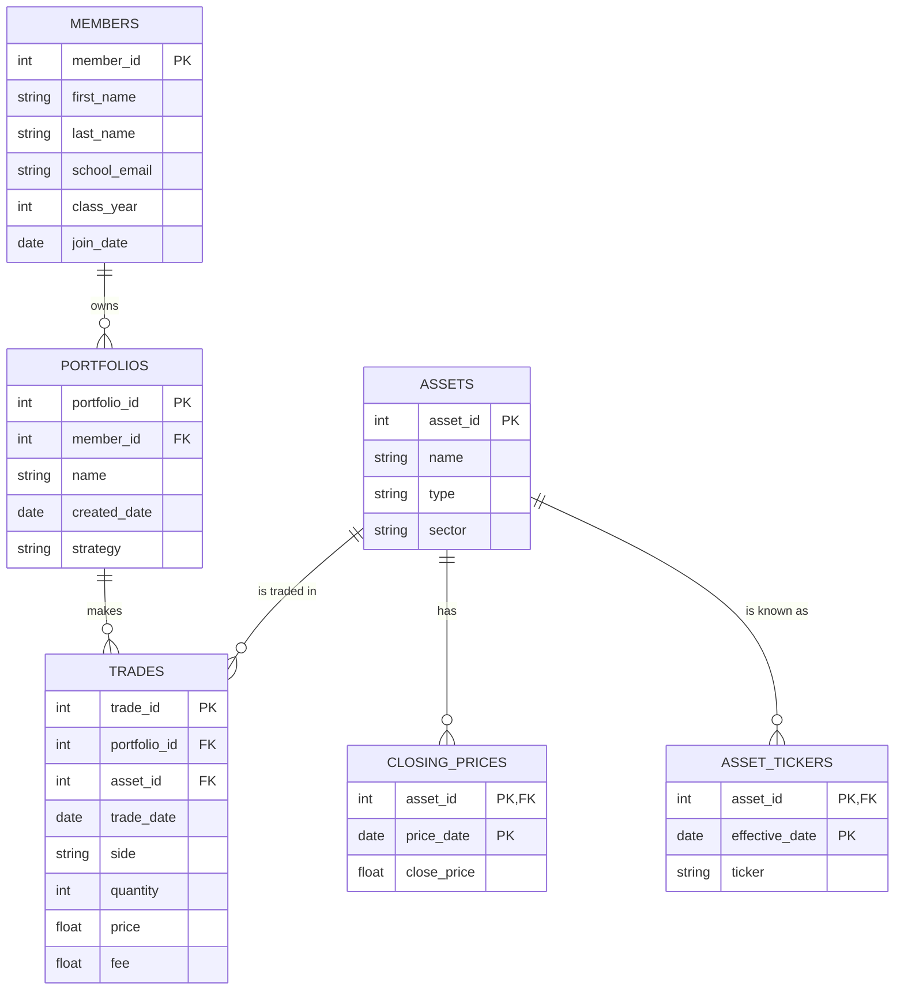

# Database Project — Babson Investment Club

## 1. The Scenario

**B · Babson Investment Club.** The club runs paper portfolios for its members to learn with. Today its records are a shared spreadsheet and screenshots from a broker. This database gives it a clear history of every trade, what each portfolio holds, and what it is worth.

## 2. The ERD

## 3. What One Row Means

- One row of `members` is one person who belongs to the club.
- One row of `portfolios` is one paper portfolio owned by one member.
- One row of `assets` is one stock, ETF or crypto the club follows, kept as one identity even if its ticker changes.
- One row of `asset_tickers` is the ticker an asset used starting on one date.
- One row of `closing_prices` is one asset's closing price on one trading day.
- One row of `trades` is one buy or sell of one asset by one portfolio on one day.

## 4. Design Choices

**The key I chose.** I used `member_id` instead of `school_email`, and `asset_id` instead of the ticker, because a school email can change after somebody graduates and a ticker can change or get reused, while an ID I invent stays the same for as long as the row exists. The ticker itself lives in `asset_tickers`, one row per ticker an asset has used.

**Optional relationships.** A new member may not have a portfolio yet, a new portfolio may not have traded yet, and an asset may be followed, with prices recorded, but never traded. None of these are mistakes — the scenario allows all three, so a row with nothing attached is a real answer.

**The rule the tables can't hold.** A portfolio can't sell more than it holds. I check it with a query that sums buys minus sells per portfolio and asset, and looks for anything below zero.

**What I changed from the agent's first try.** I asked the agent to change `quantity` for crypto trades to be a decimal instead of a whole number, since crypto is bought and sold in fractions.
